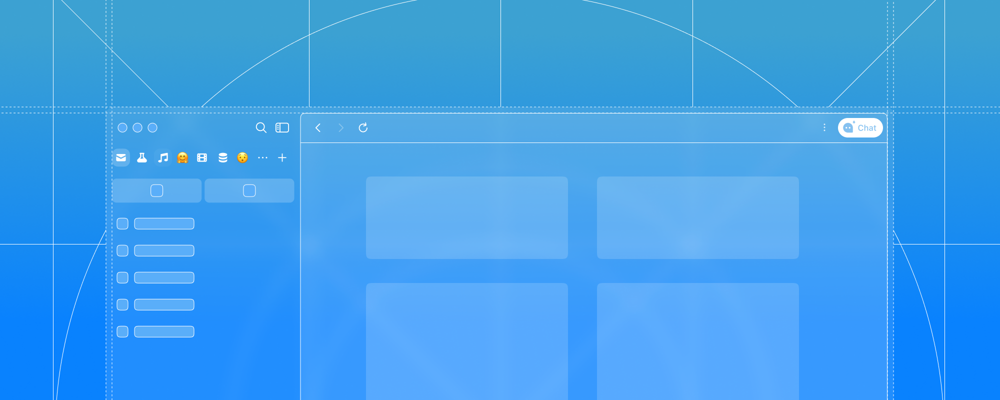

# Phi Browser

**A crafted front door to the internet.**

*Simple until asked for more, made for humans and whichever AI tools they use, and local first so data and privacy stay where they belong.*

Phi Browser is a Chromium-based browser built as a real native macOS app (AppKit + SwiftUI). It is a clean everyday browser first, with the power tools one reach away. AI is welcome and never required: AI agents can work in it beside you, what it remembers stays in a file on your Mac that you can read, and the models can run entirely on your own machine.

**Download Phi Browser** (free, Apple Silicon): [**phibrowser.com**](https://phibrowser.com)  
Like it? A ⭐ helps a lot.

 

## Why Phi Browser

- **Simple.** It opens clean and fast. Nothing in your way.
- **Powerful when you ask.** Spaces, profiles, split views, tab groups, URL rules, shortcuts, Raycast, picture-in-picture. All there. None of it in your face.
- **A real Mac app.** Native AppKit and SwiftUI on a real Chromium engine. Fast, and at home on your Mac.
- **AI is optional.** On or off, your call. It is a great browser either way.
- **Any AI is welcome.** Use ours. Run your own models on your own Mac with LM Studio or Ollama, no account needed. Or let the AI tools you already use drive Phi Browser for you.
- **Your data stays home.** Its memory lives on your device, in a file you can read, edit or wipe. We don't collect it. We don't train on it.
- **No lock-in.** No ad business. No search business. We win only if you like the browser.
- **Open source.** The Phi Browser you download is built from this repo. Read it, build it, fix it.

 

## What this repository is

This is the source of the Phi Browser macOS client, published under Apache 2.0. It is not a mirror or a snapshot: the Phi Browser you download from phibrowser.com is built from this repository, from these commits. A fix that lands here lands in the browser people are actually using.

We publish it for a fairly simple reason. A browser sees everything you do, and we would rather you could read the code that runs it than take our word for how it behaves. Developing in the open tends to produce better software too: bugs get found that we would have missed, and people who care about one detail more than we ever could come and fix it properly.

Not all of Phi Browser is here, and we would rather point at the line than let you discover it. The browser engine is our own Chromium build. We release it as a built binary you can download and link against, and you need it to build this repository, but its source is not published. The server side stays with us as well: the models, the prompts, and the pipelines behind the AI features. Phinomenon Inc. is a company rather than a foundation, and that shapes where the boundary sits. Section 1 of our [Terms of Use](https://phibrowser.com/terms/) sets out the same boundary in legal language.

### A build you make yourself

The Apache licence gives you the right to build this source, change it, and ship it. A build you make is your own browser. It is not the Phi Browser we distribute, and the two are not interchangeable.

A self-built Phi Browser does not sign in to a Phi account, does not reach Phi Cloud, does not sync, and does not use our connectors or messaging relay. It does not receive our updates: the updater is part of what we ship, not part of what we publish. It carries your signature or none.

Our [Terms of Use](https://phibrowser.com/terms/) and [Privacy Statement](https://phibrowser.com/privacy/) cover the application we distribute from phibrowser.com. They do not cover a build you made.

Do not present a build of your own as the application we distribute.

 

## Build from source

### Requirements
- Mac with Apple Silicon
- Xcode 26+
- `Phi Framework.framework` (built binary, see above)

### Steps
1. Check out this repository.
2. Install the latest `Phi Framework` using either method:
   - **Automatically:** Run `./scripts/download_phi_framework.sh` from the repository root. The script downloads the latest macOS release, verifies its SHA-256 digest, and installs it into `Frameworks/`. Pass `--version 2.17.0` to install a specific release.
   - **Manually:** From [phibrowser/phibrowser-framework releases](https://github.com/phibrowser/phibrowser-framework/releases), pick the newest macOS release (tagged `mac-vX.Y.Z`, titled "Phi Browser Framework for macOS vX.Y.Z") and download `phi-browser-framework-mac.zip`. Older macOS releases are tagged `vX.Y.Z` and ship `Phi.Framework.zip`; `win-v*` releases are for Windows. Extract the zip and place `Phi Framework.framework` into the root `Frameworks/` directory.
3. Open `Phi.xcodeproj` in Xcode and let Swift Package Manager resolve dependencies.
4. Select the `PhiBrowser-OpenSource` scheme.
5. Build.

 

## Contributing

Because the Phi Browser we distribute is built from this repository, a contribution accepted here reaches everyone using Phi Browser. You are not patching a side project or a public mirror; you are changing the browser that ships.

Contributions are welcome: bug reports, feature requests, documentation, and pull requests. Found a bug or have an idea? Open an issue first. To contribute code, send a PR with a clear description of the change and the motivation behind it.

### Getting in touch

- **Discord** for community chat, and for talking to the people who build Phi Browser in something close to real time: [discord.com/invite/aj7rumAMgC](https://discord.com/invite/aj7rumAMgC)
- **X** for development news as it happens: [@phibrowser](https://x.com/phibrowser)
- **Security issues: please tell us privately first, at [hi@phi.cc](mailto:hi@phi.cc).** Not in an issue, not in a PR, not on Discord. Give us the chance to fix it before it is public.

### Translations

Phi Browser ships in 8 languages, currently machine-seeded and waiting for native speakers to make them feel right. If you can read a JSON file, you can help: every user-visible string in the Phi product family lives in [phibrowser/phi-i18n](https://github.com/phibrowser/phi-i18n), each with context on where it appears and what it does. Translations merged there flow into the next Phi Browser build automatically, credited to you. Prefer a web UI over git? Our Weblate is live at [i18n.phibrowser.com](https://i18n.phibrowser.com): browse every string without an account, sign in to translate, with a shared glossary and context for each one.

 

## License

Apache License 2.0. See [LICENSE](LICENSE). The bundled `Phi Framework.framework` is not covered by that licence; it is our proprietary build, redistributed to you as a binary. Third-party components are listed in the credits page reachable from **About Phi**, and the Chromium engine's own components at `chrome://credits`.
